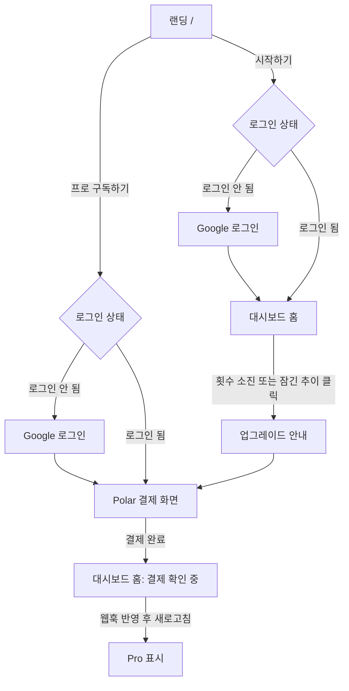
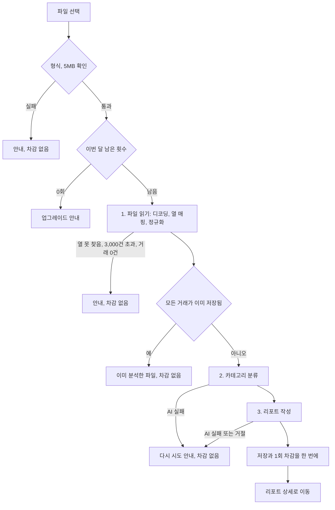
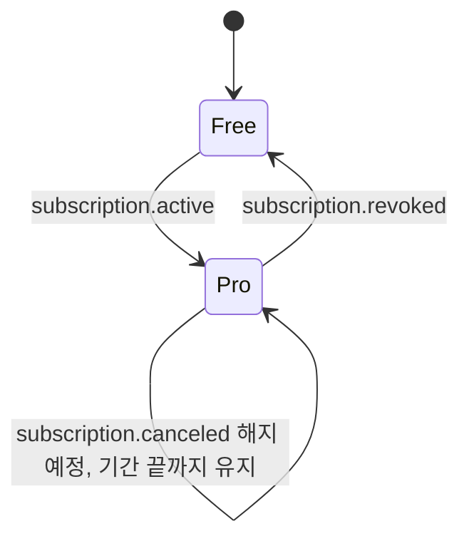

# PRD: FinSight

## 목표
카드 명세서를 올리기만 하면, 어디에 돈이 새는지와 무엇을 줄일 수 있는지를 AI가 한국어 리포트로 알려준다.

## 단계와 범위
- MVP·프로토타입. 결제는 Polar sandbox(테스트 카드)만 사용하고 실제 청구는 없다.
- 실결제, 약관, 개인정보 처리방침, 사업자 정보는 범위 밖이다.

## 사용자
- 한국 개인 사용자. 한국어 화면, 원화.
- 페르소나: 카드 2~3장을 쓰는 20~30대 직장인. 매달 "왜 이렇게 많이 썼지?" 싶지만 가계부를 직접 쓰기는 귀찮다. 카드사 웹·앱에서 이용내역을 엑셀이나 CSV로 내려받을 수 있다.

## 핵심 기능
1. **Google 로그인**: 대시보드는 로그인해야 들어갈 수 있다.
2. **명세서 업로드**: CSV, xls, xlsx. 한 번에 한 파일, 최대 5MB, 3,000건.
3. **핵심 리포트**: 업로드 1건마다 리포트 1건. 카테고리별 지출 요약, 정기결제·구독 탐지, 이상 지출, 절약 제안.
4. **월별 추이 (Pro)**: 월별 총지출 차트와 카테고리별 전월 대비 증감 표. 저장된 거래로 코드가 계산하며 AI를 쓰지 않는다.
5. **구독**: Free와 Pro(월 1,000원). Pro는 더 강한 모델(Opus 5.5)이 리포트를 쓴다. 결제는 Polar checkout, 해지·카드 변경은 Polar 고객 포털. 화면에서는 "무료"와 "프로"로 부른다.
6. **내 데이터 전체 삭제**: 설정 화면의 버튼 하나로 거래와 리포트를 모두 지운다. 계정, 구독, 이번 달 사용 횟수는 유지된다.

## 요금제
| | Free | Pro (월 1,000원) |
|---|---|---|
| 월 분석 횟수 | 3회 | 30회 |
| 핵심 리포트 | O (Claude Sonnet 5.5) | O (Claude Opus 5.5, 더 깊은 분석) |
| 월별 추이 | 잠금 + 업그레이드 안내 | O |

- 횟수는 매월 1일 00:00(KST)에 초기화된다. 리포트 생성에 성공했을 때만 1회 차감한다.
- Pro 구독은 랜딩의 요금제 섹션에서 시작한다. 대시보드에서도 횟수를 다 쓰거나 잠긴 월별 추이를 누르면 업그레이드를 안내한다.
- 요금제와 결제 화면 근처에 "테스트 결제 환경이며 실제로 청구되지 않습니다"라고 표시한다.
- 해지하면 이번 결제 기간이 끝날 때까지 Pro가 유지되고, 그 뒤 Free가 된다. 저장된 데이터는 남고, 월별 추이가 다시 잠기며 새 리포트는 Sonnet 5.5가 쓴다.

## 업로드와 분석 규칙
- **열 매핑**: 파일 상단 최대 10행을 Haiku 5.5에 보내 헤더 행과 날짜·가맹점·원화 이용금액 열을 찾는다. 보내기 전에 6자리 이상 연속된 숫자(카드번호, 승인번호 등)는 마스킹한다.
- **사용 열**: 날짜·가맹점·금액만 쓰고 나머지 열은 버린다.
- **금액**: 명세서의 원화 금액을 그대로 쓴다.
  - 취소·환불은 음수로 상계한다.
  - 할부는 이용일에 전체 금액으로 잡는다.
  - 날짜나 금액을 읽을 수 없는 행(원화 금액이 비어 있는 해외결제 등)은 빼고, 리포트에 "제외 N건"으로 표시한다.
- **카테고리** (고정 10개, Haiku 5.5가 가맹점 단위로 분류하며 사용자는 수정할 수 없다): 식비 / 카페·간식 / 교통 / 쇼핑 / 구독·정기결제 / 주거·통신 / 의료·건강 / 문화·여가 / 교육 / 기타
- **중복**:
  - 이전 업로드에 같은 (날짜, 가맹점, 금액) 거래가 있으면 그 거래는 저장하지 않는다.
  - 같은 파일 안에서 겹치는 거래는 모두 저장한다.
  - 파일의 모든 거래가 이미 있으면 "이미 분석한 파일"로 안내하고 횟수를 차감하지 않는다.
- **리포트 대상**: 리포트는 그 파일의 거래 전체로 작성한다. 이전 업로드와 겹치는지는 상관없다.
- **분석 중 화면**: 스피너와 "분석 중이에요. 1~2분 걸릴 수 있어요" 문구만 보여준다. 끝나면 리포트 상세로 이동한다.
- **실패 처리**: 도중에 실패하면 아무것도 저장하지 않고 횟수도 차감하지 않는다. 사용자는 같은 파일로 다시 시도할 수 있다.
- **저장**: 원본 파일은 저장하지 않는다. 정리된 거래(날짜, 가맹점, 금액, 카테고리)와 리포트만 사용자별로 저장한다.

## 화면
| 경로 | 화면 | 내용 |
|---|---|---|
| `/` | 랜딩 | 히어로(로그인 전 "시작하기", 로그인 후 "대시보드로 가기") → 사용 방법 3단계(로그인 → 명세서 업로드 → AI 리포트 확인) → 요금제 비교("프로 구독하기") → 푸터 |
| `/login` | 로그인 | "Google 계정으로 로그인" 버튼 하나. 로그인 후 원래 가려던 곳으로 이동 |
| `/dashboard` | 홈 | 업로드 영역, 이번 달 남은 횟수, 최근 리포트 목록, 플랜 표시 |
| `/dashboard/reports/[id]` | 리포트 상세 | 요약 숫자(총지출, 건수, 기간, 제외 건수), 카테고리 차트, 정기결제, 이상 지출, 절약 제안 |
| `/dashboard/trends` | 월별 추이 | Pro: 월별 총지출 차트 + 카테고리 증감 표 / Free: 잠금 + 업그레이드 버튼 |
| `/dashboard/settings` | 설정 | 플랜, 구독 관리(Polar 포털), 내 데이터 전체 삭제, 로그아웃 |

## 사용자 흐름

### 진입과 구독

### 업로드와 분석

### 구독 상태

## 시나리오
| 구분 | 상황 | 동작 |
|---|---|---|
| 정상 | 첫 방문 → 로그인 → 업로드 | 리포트 생성, 남은 횟수 3 → 2 |
| 정상 | 카드 3장 명세서를 각각 업로드 | 카드별 리포트 3건, 월별 추이(Pro)에서 합쳐서 보임 |
| 정상 | Free가 잠긴 월별 추이 클릭 → 결제 | Polar 결제 → 웹훅 반영 → 추이 열림, 한도 30회 |
| 정상 | Pro 해지 | 기간 끝까지 Pro, `revoked` 후 Free(데이터 유지) |
| 예외 | 지원하지 않는 형식, 5MB 초과 | 업로드 단계에서 안내, 차감 없음 |
| 예외 | 3,000건 초과, 날짜·가맹점·금액 열을 못 찾음, 거래 0건 | "파일 읽기" 단계에서 안내, 차감 없음 |
| 예외 | 같은 파일 재업로드 | "이미 분석한 파일", 차감 없음 |
| 예외 | 날짜나 금액을 읽을 수 없는 행(원화 금액이 빈 해외결제 등) | 제외하고 리포트에 "제외 N건" |
| 예외 | AI 호출 실패, 거절, 출력 잘림 | 아무것도 저장 안 함, 차감 없음, 다시 시도 안내 |
| 예외 | 남은 횟수 0 | 업로드 전에 업그레이드 안내 |
| 예외 | 로그인 없이 `/dashboard` 접근 | `/login`으로 이동, 로그인 후 원래 경로로 복귀 |
| 예외 | 결제 직후 웹훅 도착 전 | Free로 보이며 "결제 확인 중" 안내, 새로고침 시 반영 |

## 가설과 지표
별도 분석 도구 없이 DB 집계로 확인한다.

| 가설 | 지표 |
|---|---|
| 첫 리포트가 쓸모 있으면 다른 카드나 다른 달 명세서도 올린다 | 첫 리포트 후 2번째 업로드 비율 |
| 횟수 소진, 잠긴 월별 추이, 더 강한 리포트 모델이 업그레이드를 만든다 | 업그레이드 안내 노출 대비 결제 시작·완료 수 |
| 엑셀을 그대로 받으면 업로드 실패가 줄어든다 | 업로드 시도 대비 리포트 성공 비율 |

## MVP 제외 사항
- AI 채팅, 예산 설정·초과 알림
- 카테고리 수정, 리포트 개별 삭제, 업로드 단위 삭제
- 여러 파일 동시 업로드, 월 단위 통합 리포트
- 연간 결제, 무료 체험, 여러 유료 등급
- 실결제, 약관, 개인정보 처리방침, 사업자 정보
- 다크 모드, 랜딩의 샘플 리포트 미리보기와 FAQ

## 한계
- 암호가 걸린 엑셀 파일은 지원하지 않는다.
- 분석 중에 화면을 떠나면 분석이 취소될 수 있다. 진행 단계는 보여주지 않는다.
- 한도는 분석을 시작할 때 한 번만 확인한다. 두 탭에서 동시에 분석하면 월 한도를 넘길 수 있다.
- 이전 업로드와 날짜·가맹점·금액이 모두 같은 실제 거래(예: 같은 날 같은 가게에서 같은 금액 결제)가 다른 파일에 있으면 하나로 합쳐진다.
- 결제 직후 Pro 반영은 웹훅이 도착할 때까지 늦을 수 있다.
- 웹훅 순서가 뒤바뀌거나 중복되는 경우는 따로 처리하지 않는다.
- sandbox에서 정기 결제 갱신이 실제로 도는지는 확인하지 못했다.
- 열 매핑 단계에서 파일 상단 행의 이름 같은 텍스트가 AI에 전달될 수 있다. 6자리 이상 숫자는 마스킹한다.
- AI가 리포트 작성을 거절하면 `ai_failed`로 안내한다. 같은 파일은 다시 시도해도 실패할 수 있다.
- 월 1,000원은 Pro 사용자가 30회를 다 쓸 때의 AI 비용보다 낮을 수 있다. 실제 출시 때 가격과 한도를 다시 정한다.

## 디자인
- 한국어 우선: 모든 화면 문구를 한국어 해요체로 쓰고, 글꼴과 줄바꿈도 한글 기준으로 맞춘다.
- 흰 배경에 초록 포인트 색 하나만 쓴다. 숫자가 가장 먼저 읽히는 차분한 금융 도구 톤이다.
- 상세 규칙은 `docs/UI_GUIDE.md`를 따른다.
