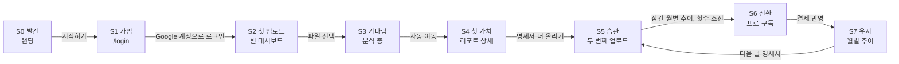

# UX 가이드: 사용자 여정과 단계 전환

처음 온 사람이 첫 리포트를 받고, 명세서를 더 올리고, 프로로 넘어가기까지 각 화면이 무엇을 해야 하는지 정한다. [Figma의 UI 디자인 원칙 7가지](https://www.figma.com/ko-kr/resource-library/ui-design-principles/)(계층 구조, 점진적 공개, 일관성, 대비, 접근성, 근접성, 정렬)를 FinSight에 맞게 옮겼다. 같은 글의 팁 중 "사용자 흐름을 먼저 정하라", "상호작용마다 피드백을 줘라", "실제 사용자로 테스트하라"는 각각 "사용자 여정", "상태별 다음 행동", "사용성 테스트" 장에 담았다.

| 무엇 | 어디 | 우선순위 |
|---|---|---|
| 기능 범위, 화면 목록, 한도, 한계 | `docs/PRD.md` | 1 |
| 모양(색, 글자, 간격, 컴포넌트), 금지 사항, 한국어 문구 규칙 | `docs/UI_GUIDE.md` → `docs/design-system/` | 2 |
| 사용자 여정, 단계별 다음 행동, 상태별 화면, 용어 | 이 문서 | 3 |

- 이 문서는 PRD 범위와 UI_GUIDE 규칙 안에서만 정한다. 둘과 부딪히면 그쪽을 따른다.
- 마지막 장의 "개선 제안"은 아직 구현되지 않았다. 화면 구성이 바뀌는 제안은 PRD의 "화면"과 ARCHITECTURE의 "화면과 컴포넌트"를 먼저 고친 뒤 구현한다.

## 핵심 원칙
1. **한 화면, 한 질문, 한 행동.** 화면마다 사용자의 질문 하나에 답하고, 다음 단계로 가는 행동 하나를 초록 버튼으로 준다. 초록 버튼이 하나뿐이라는 UI_GUIDE 규칙은 곧 "다음 단계는 하나"라는 뜻이다.
2. **막다른 화면이 없다.** 빈 상태, 오류, 잠금, 횟수 소진, 완료 화면에도 다음에 할 일을 적고 버튼이나 링크를 둔다.
3. **가치 먼저, 결제는 나중.** 첫 리포트를 보기 전에는 프로를 권하지 않는다. 업그레이드 안내는 사용자가 프로 기능에 직접 닿았을 때(잠긴 월별 추이, 횟수 소진)만 초록 버튼으로 보여준다.
4. **하려던 일로 돌려보낸다.** 로그인 뒤에는 `next` 경로로, 결제 뒤에는 대시보드로 돌아와 원래 하던 일을 이어 간다. 중간에 다른 화면을 끼워 넣지 않는다.
5. **불안은 결정하는 자리에서 푼다.** 개인정보 안내는 업로드 버튼 가까이, 가격과 테스트 결제 문구는 결제 버튼 바로 아래, "횟수는 차감되지 않았어요"는 오류 안내 안에 둔다.
6. **기다리기 전에 알려준다.** 얼마나 걸리는지, 끝나면 어디로 가는지, 무엇을 하면 안 되는지를 먼저 말한다.

## 사용자 여정
페르소나: 카드 2~3장을 쓰는 20~30대 직장인. "왜 이렇게 많이 썼지?" 싶지만 가계부는 귀찮다(PRD).

| 단계 | 사용자의 질문 | 화면 | 다음 단계 행동(초록 버튼) | 넘어갔다는 기준 |
|---|---|---|---|---|
| S0 발견 | 이게 뭐고, 나한테 쓸모 있나? | `/` 히어로 | 시작하기 | `/login` 진입 |
| S1 가입 | 가입이 귀찮지 않나? 내 금융 정보는 괜찮나? | `/login` | Google 계정으로 로그인 | `profiles` 행 생성 |
| S2 첫 업로드 | 파일은 어디서 받지? 어떤 걸 올리지? | `/dashboard` (리포트 0건) | 업로드 영역(파일 선택) | 분석 요청 시작 |
| S3 기다림 | 얼마나 걸리지? 잘 되고 있나? | `AnalyzingState` | 없음(끝나면 자동 이동) | 리포트 생성 |
| S4 첫 가치 | 그래서 어디에 새고 있지? | `/dashboard/reports/[id]` | 명세서 더 올리기 | 두 번째 분석 시작 |
| S5 습관 | 다른 카드까지 보면 전체가 보이겠네 | `/dashboard` (리포트 1건 이상) | 업로드 영역 | 리포트 2건 이상 |
| S6 전환 | 매달 합쳐 보려면 프로가 필요하네 | 잠긴 월별 추이, 횟수 소진 | 프로 구독하기 | `profiles.plan = 'pro'` |
| S7 유지 | 지난달보다 줄었나? | `/dashboard/trends` | 명세서 올리기(새 달) | 다음 달에도 업로드 |

### S0 발견: 랜딩
- **목표**: 5초 안에 "명세서 파일 하나만 올리면 된다"를 이해시키고 "시작하기"를 누르게 한다.
- **계층**: 히어로 제목(무엇을 얻는가) → 부제(무엇을 하면 되는가) → 시작하기 → 사용 방법 3단계 → 요금제. 첫 화면 안에 제목, 부제, 버튼이 모두 보여야 한다.
- **망설이는 이유와 대응**
  - "가입이 귀찮다" → 사용 방법 1단계에 "가입 절차 없이 바로 시작해요"를 둔다(있음).
  - "금융 정보를 올려도 되나" → 버튼 바로 아래 캡션에 무엇을 저장하지 않는지 적는다. 예: "원본 파일은 저장하지 않아요. 날짜·가맹점·금액만 남겨요." 실제 처리(CLAUDE.md, ADR-007)와 다른 약속은 쓰지 않는다. "AI에 아무것도 보내지 않아요"처럼 사실이 아닌 문장은 금지다.
  - "돈이 드나" → 같은 캡션이나 요금제에서 "무료로 매달 3회"를 보여준다.
- **하지 않는 것**: 샘플 리포트 미리보기, FAQ(PRD 제외 사항), 사용자 수·후기 같은 확인할 수 없는 숫자, 스크롤 연출.

### S1 가입: 로그인
- **목표**: 버튼 하나로 끝낸다. 생각할 거리를 늘리지 않는다.
- **구성**: 로고(누르면 랜딩 `/`, 브라우저 뒤로 가기 말고도 돌아갈 길) → 한 문장("Google 계정으로 바로 시작해요") → "Google 계정으로 로그인" 버튼 하나.
- **맥락 유지**: `next`가 `/api/checkout`이면 문장을 "로그인하면 프로 구독 결제로 이어져요"로 바꾼다. 사용자가 왜 이 화면에 왔는지 알게 한다.
- **실패**: "로그인하지 못했어요. 다시 시도해 주세요."를 버튼 바로 아래에 둔다(있음). 버튼은 다시 누를 수 있어야 한다.

### S2 첫 업로드: 빈 대시보드
가장 많이 떠나는 단계다. 명세서 파일을 아직 받지 않은 사람이 많다.
- **목표**: 카드사에서 파일을 받아 올리게 한다.
- **계층**: 업로드 영역이 맨 위, 가장 크다. 남은 횟수와 빈 리포트 목록은 그 아래 보조 정보다.
- **점진적 공개**
  - 업로드 영역 바로 아래에 "명세서 받는 법"을 접어 둔다(`
`). 펼치면 세 줄만 보여준다: 카드사 홈페이지나 앱의 이용내역 메뉴로 간다 → 기간을 고르고 엑셀이나 CSV로 내려받는다 → 받은 파일을 그대로 올린다. 카드사별 메뉴 경로는 바뀌기 쉬우니 적지 않는다.
  - 첫 파일은 "지난 한 달 이용내역 하나"를 권한다. 고를 것을 줄이고 첫 리포트를 빨리 보게 한다.
  - 파일 조건(CSV, xls, xlsx · 한 파일 · 5MB · 3,000건)은 업로드 영역 안에 이미 있다. 암호가 걸린 엑셀은 지원하지 않는다는 점은 "명세서 받는 법" 안에 적는다.
- **진행 표시**: 리포트가 0건일 때만 빈 목록 자리에 랜딩과 같은 3단계를 진행 상태로 보여준다. "Google로 로그인(완료) → 명세서 올리기(지금) → AI 리포트 확인(1~2분 뒤)". 랜딩에서 한 약속을 그대로 이어 보여주는 장치다. 지금 단계에 `aria-current="step"`을 둔다.
- **하지 않는 것**: 첫 리포트 전 프로 안내, 투어·코치마크·모달 온보딩.

### S3 기다림: 분석 중
- **목표**: 1~2분 동안 화면을 떠나지 않게 한다.
- **구성**: 스피너와 두 문장. "분석 중이에요. 1~2분 걸릴 수 있어요" / "끝나면 리포트로 바로 이동해요. 이 화면을 벗어나면 분석이 취소될 수 있어요." 두 번째 문장은 PRD "한계"(화면을 떠나면 취소될 수 있음)를 사용자에게 미리 알리는 것이다.
- **하지 않는 것**: 가짜 진행률, 단계 표시(ADR-008), 기다리는 동안의 프로 광고, 팁 회전 같은 애니메이션.

### S4 첫 가치: 리포트 상세
FinSight의 "아하" 순간이다. 여기서 두 번째 업로드로 이어지는지가 첫 번째 가설(PRD "가설과 지표")이다.
- **목표**: 새는 돈 하나를 발견하게 하고, 다른 카드나 다른 달 명세서를 올리게 한다.
- **계층(읽는 순서 = 놓는 순서)**: 총지출(`number-xl`) → AI 요약 한 문단 → 카테고리 막대 → 정기결제·구독 → 이상 지출 → 절약 제안 → 다음 단계 카드.
- **신뢰**: 제외 건수가 1건 이상이면 요약 숫자 아래 캡션으로 이유를 적는다. 예: "날짜나 원화 금액을 읽지 못한 거래 N건은 뺐어요." 숫자는 코드가 넣는다.
- **다음 단계 카드**: 리포트 맨 끝, 절약 제안 바로 아래 카드 하나. 이 화면의 초록 버튼은 이것 하나다.

| 조건 | 제목 | 설명 | 버튼 |
|---|---|---|---|
| 남은 분석 1회 이상 | 다른 카드 명세서도 올려 보세요 | 카드가 여러 장이면 각각 올려야 전체 지출이 보여요. 이번 달 N회 남았어요. | 명세서 더 올리기 → `/dashboard` |
| 무료, 남은 분석 0회 | 이번 달 분석을 모두 썼어요 | 프로는 매달 30회까지 분석하고 월별 추이도 볼 수 있어요. | 프로 구독하기 → `/api/checkout` + 테스트 결제 문구 |
| 프로, 남은 분석 0회 | 이번 달 분석을 모두 썼어요 | 다음 달 1일에 다시 채워져요. | 월별 추이 보기 → `/dashboard/trends` |

### S5 습관: 두 번째 업로드부터
- **목표**: 카드별로, 달별로 명세서를 쌓게 한다.
- **구성**: 업로드 영역은 그대로 맨 위에 둔다. 최근 리포트 목록은 가장 최근 리포트가 위에 오고, 첫 행 아이콘만 `primary-soft`로 강조한다(있음).
- **남은 횟수**: `UsageMeter`는 남은 양을 막대로 보여준다(있음). 무료 사용자에게 1회 남았을 때 캡션을 "이번 달 마지막 분석이에요"로 바꿔 미리 알린다. 겁주는 말은 쓰지 않는다.
- **이미 분석한 파일**: 오류가 아니라 기본 `Notice`로 "새 거래가 있는 파일을 올려 주세요"를 안내한다. 업로드 영역은 바로 다시 쓸 수 있어야 한다.

### S6 전환: 프로 구독
업그레이드는 두 가지 상황에서만 초록 버튼으로 권한다. 둘 다 사용자가 프로 기능에 이미 손을 뻗은 순간이다.

| 진입점 | 화면 | 보여줄 것 |
|---|---|---|
| 잠긴 월별 추이 | `/dashboard/trends` (무료) | `LockedPanel`: 잠금 배지 → 제목 → 한 문장 → 가격 → 프로 구독하기 → 테스트 결제 문구 |
| 횟수 소진 | `/dashboard` 업로드 영역 자리, 리포트 상세의 다음 단계 카드 (무료, 0회) | 같은 `LockedPanel` 형식(디자인 시스템 LockedPanel 명세). 제목 "이번 달 분석 3회를 모두 썼어요" |
| 그 밖 | 랜딩 요금제, 설정의 플랜 행, 헤더의 "월별 추이" 잠금 배지 | 보조 버튼이나 배지만. 초록 버튼을 쓰지 않는다 |

- **가치를 실제 숫자로 보여준다**: 무료 사용자가 이미 올린 거래도 저장되어 있으므로, 잠긴 월별 추이에서 "저장된 거래 N건으로 바로 월별 추이를 볼 수 있어요"라고 쓴다. N은 코드가 센다. 흐린 가짜 차트는 쓰지 않는다(UI_GUIDE).
- **결정에 필요한 것은 버튼 옆에 모두 둔다**: 가격(`NEXT_PUBLIC_PRO_PRICE_LABEL`), "구독 관리에서 언제든 해지할 수 있어요", "테스트 결제 환경이며 실제로 청구되지 않습니다".
- **대시보드 안에서는 결제로 바로 간다**: 로그인한 사용자를 랜딩 요금제(`/#pricing`)로 돌려보내지 않고 `/api/checkout`으로 보낸다. 버튼 이름은 어디서나 "프로 구독하기"다.
- **결제 뒤**: `/dashboard?checkout=success`로 돌아온다.
  - 아직 무료면 기본 `Notice` "결제 확인 중이에요. 잠시 뒤 새로고침해 주세요."(있음).
  - 이미 프로면 성공 `Notice` "프로 구독을 시작했어요. 이제 월별 추이를 볼 수 있어요." + 텍스트 버튼 "월별 추이 보기". 축하 애니메이션이나 색종이는 쓰지 않는다.
- **하지 않는 것**: 업로드 전에 띄우는 결제 모달, 리포트 중간에 끼운 프로 배너, 닫기 어려운 팝업, "지금 안 하면 손해" 같은 압박 문구.

### S7 유지: 월별 추이와 해지
- **목표**: 매달 새 명세서를 올려 지난달과 비교하게 한다.
- **데이터가 부족할 때**
  - 저장된 거래 0건: "아직 저장된 거래가 없어요" + 초록 버튼 "명세서 올리기"(지금은 문구만 있고 버튼이 없다).
  - 한 달 치만 있음: 차트는 보여주고, 증감 표 자리에 "지난달 명세서를 올리면 카테고리별로 늘고 준 금액을 볼 수 있어요" + "명세서 올리기".
- **해지**: 설정 → "구독 관리"(Polar 포털). 해지 뒤에도 데이터가 남는다는 점을 설정의 구독 관리 설명에 적는다. 예: "해지해도 이번 결제 기간까지 프로가 유지되고, 저장된 거래와 리포트는 그대로예요."

## 원칙별 적용 규칙
Figma의 원칙 7가지를 FinSight에서 어떻게 지키는지 적는다. 모양과 값은 UI_GUIDE와 디자인 시스템을 따른다.

### 1. 계층 구조
- 화면마다 가장 먼저 읽힐 것 하나를 정하고, 그것이 가장 크고 진하다.

| 화면 | 1순위 | 2순위 | 3순위 |
|---|---|---|---|
| 랜딩 | 히어로 제목(`display-lg`) | 시작하기 | 사용 방법, 요금제 |
| 대시보드 | 업로드 영역 | 남은 분석 숫자(`number-lg`) | 최근 리포트 |
| 리포트 상세 | 총지출(`number-xl`) | AI 요약, 카테고리 막대 | 구독·이상 지출·절약 제안, 다음 단계 |
| 월별 추이 | 월별 총지출 막대 | 카테고리 증감 표 | 안내 문구 |
| 설정 | 플랜 | 구독 관리 | 데이터 삭제, 로그아웃 |
- 제목 단계는 페이지 `title-lg` → 카드 `title-md` → 업로드·분석 문구 `title-sm`만 쓴다. `h1`은 화면에 하나다.
- 숫자 옆의 단위(원·건·회)는 숫자보다 작게 둔다. 숫자를 먼저 읽게 하려는 것이다.

### 2. 점진적 공개
- 한 단계에서는 그 단계의 결정 하나만 묻는다. 로그인 화면에서 요금제를 고르게 하지 않고, 업로드 전에는 결제를 말하지 않는다.
- 자세한 내용은 필요할 때 펼친다: 명세서 받는 법(접기), 인사이트별 거래 목록(인사이트 바로 아래), 오류 안내(오류가 났을 때만).
- 프로 기능은 숨기지 않고 잠근다. 헤더의 "월별 추이"에 잠금 배지를 달아 존재를 알리고, 누르면 잠금 카드로 이유와 방법을 보여준다(있음).
- 진행 상황은 두 가지로만 보여준다: 첫 방문의 3단계 표시, `UsageMeter`의 남은 횟수. 분석 단계는 보여주지 않는다(ADR-008).

### 3. 일관성
- 같은 행동은 어디서나 같은 이름, 같은 버튼 변형, 같은 목적지다. 아래 용어표를 따른다.
- 새 화면은 기존 컴포넌트 조합으로 만든다. 업그레이드 안내는 `LockedPanel`, 화면 안 안내는 `Notice`, 목록은 `ReportListItem`·`SettingsRow` 형식이다.
- 랜딩의 3단계(로그인 → 명세서 올리기 → 리포트 확인)와 대시보드 진행 표시는 같은 단계 이름을 쓴다.

| 쓰는 말 | 쓰지 않는 말 | 비고 |
|---|---|---|
| 명세서 | 거래내역 파일, 데이터 | 형식을 말할 때만 "CSV·엑셀" |
| 올리다, 명세서 올리기 | 업로드(화면 문구) | 문서와 코드에서는 업로드 |
| 분석, 분석 횟수, 남은 분석 | 사용 횟수, 크레딧, 토큰 | |
| 리포트 | 보고서, 레포트 | |
| 무료, 프로 | Free, Pro, 프리미엄, 유료 회원 | |
| 프로 구독하기 | 업그레이드, 결제하기, 요금제 살펴보기(대시보드 안) | 목적지는 `/api/checkout` |
| 월별 추이 | 트렌드, 통계 | |
| 제외 N건 | 오류 N건, 실패 N건 | |
| 구독 관리 | 결제 관리, 해지하기 | 목적지는 Polar 포털 |
| 내 데이터 전체 삭제 | 계정 삭제, 탈퇴 | 계정은 남는다 |

### 4. 대비
- 초록 버튼은 그 화면의 다음 단계 하나다. 다음 단계가 아닌 행동(로그아웃, 구독 관리, 다른 화면 가기)은 보조나 텍스트 버튼이다.
- 업그레이드 버튼은 잠금 카드와 횟수 소진 카드에서만 초록이다. 랜딩 요금제와 설정에서는 보조 버튼이다.
- `danger`(빨강)는 "내 데이터 전체 삭제"와 오류 아이콘에만 쓴다. 증감의 빨강·파랑은 글자색으로만 쓴다.
- 비활성(횟수 소진 업로드 영역)은 회색으로 낮추고, 대신 바로 아래 카드가 다음 행동을 대비로 끌어올린다.

### 5. 접근성
- 대비: 글자는 바탕 위 4.5:1 이상, 컨트롤 경계는 3:1 이상(`tokens.json` 기준값).
- 색만으로 뜻을 전하지 않는다: 증감은 ▲/▼와 부호, 안내는 아이콘(i / ✓ / !)과 함께 쓴다.
- 키보드만으로 랜딩부터 Polar 결제 화면 진입까지 갈 수 있어야 한다. 업로드 영역은 `label` + 파일 입력이라 끌어다 놓지 않아도 Enter/Space로 열린다. 포커스 링은 2px `focus` 실선이다.
- 상태 변화는 읽어 준다: 분석 중은 `role="status"`, 오류는 `role="alert"`, 남은 횟수는 `role="meter"`, 현재 메뉴는 `aria-current="page"`, 진행 표시의 현재 단계는 `aria-current="step"`.
- 누를 수 있는 것은 높이 44px 이상, 목록 행 56px 이상이다. 마우스 올림(hover)으로만 보이는 정보는 두지 않는다.
- 375px 폭에서 깨지지 않아야 한다. 표는 가로 스크롤을 허용한다.
- `prefers-reduced-motion`이면 스피너를 느리게 돌린다(있음).

### 6. 근접성
- 결정을 돕는 정보는 그 버튼에 붙인다: 테스트 결제 문구·가격은 결제 버튼 바로 아래, 파일 조건은 업로드 영역 안, 개인정보 캡션은 시작하기 바로 아래.
- 인사이트와 근거 거래는 한 묶음이다. 관찰 문장 바로 아래에 날짜·가맹점·금액을 둔다(있음).
- 다음 단계 카드는 읽기가 끝나는 자리(리포트 맨 끝)에 둔다. 리포트 중간에 끼우지 않는다.
- 되돌릴 수 없는 행동은 떨어뜨리고 한 번 더 묻는다. "전체 삭제"는 확인 대화상자를 거친다(있음).

### 7. 정렬
- 좌측 정렬이 기본이다(랜딩 히어로 포함). 가운데 정렬은 로그인, 분석 중, 잠금 카드처럼 화면에 할 일이 하나뿐인 경우만 쓴다.
- 대시보드는 960px 한 열, 랜딩은 1200px. 카드 안쪽과 카드 사이는 `space-lg`(24px)로 맞춘다.
- 금액은 오른쪽 정렬, `tabular-nums`다. 같은 열의 금액은 자릿수가 세로로 맞아야 한다.

## 상태별 다음 행동
모든 상태는 "지금 무슨 상태인지 + 다음에 할 일"을 함께 보여준다. "있음"은 지금 구현되어 있다는 뜻이다.

| 화면 | 상태 | 보여줄 것 | 다음 행동 |
|---|---|---|---|
| 대시보드 | 첫 방문(리포트 0건) | 업로드 영역, 명세서 받는 법(접기), 3단계 진행 표시 | 파일 선택 |
| 대시보드 | 리포트 있음 | 업로드 영역, 남은 분석, 최근 리포트(있음) | 파일 선택, 리포트 열기 |
| 대시보드 | 분석 중 | 스피너 + 두 문장 | 기다림(자동 이동) |
| 대시보드 | 분석 오류 | 오류 `Notice`: 무슨 일(굵게) → 할 일 → "횟수는 차감되지 않았어요"(있음) | 업로드 영역에서 다시 선택 |
| 대시보드 | 이미 분석한 파일 | 기본 `Notice` | 다른 파일 선택 |
| 대시보드 | 무료, 0회 | 비활성 업로드 영역 + 업그레이드 카드 | 프로 구독하기 |
| 대시보드 | 프로, 0회 | 비활성 업로드 영역 + "다음 달 1일에 다시 채워져요" | 리포트 열기 |
| 대시보드 | 결제 직후, 아직 무료 | "결제 확인 중이에요"(있음) | 새로고침 |
| 대시보드 | 결제 직후, 프로 반영됨 | 성공 `Notice` | 월별 추이 보기 |
| 리포트 상세 | 정상 | 요약 → 막대 → 인사이트 → 절약 제안 → 다음 단계 카드 | 명세서 더 올리기 |
| 리포트 상세 | 인사이트 0개 | "항목이 발견되지 않았어요"(있음) | 다음 단계 카드 |
| 월별 추이 | 무료 | 잠금 카드(가격, 저장된 거래 수) | 프로 구독하기 |
| 월별 추이 | 프로, 거래 0건 | 안내 + 버튼 | 명세서 올리기 |
| 월별 추이 | 프로, 한 달 치 | 차트 + 비교 안내 | 명세서 올리기 |
| 설정 | 무료 | 플랜 행에 보조 버튼 | 프로 구독하기 |
| 설정 | 삭제 완료 | 성공 `Notice`(있음) | 홈에서 다시 올리기 |
| 공통 | 없는 주소(404), 불러오기 실패 | 한국어 안내 한 문장 | 대시보드로 가기, 다시 시도 |

## 지표
PRD대로 별도 분석 도구 없이 DB 집계로 본다. 단계 사이 전환율은 아래 기준으로 센다.

| 전환 | 계산 | 출처 |
|---|---|---|
| 가입 → 첫 리포트 | 리포트가 1건 이상인 사용자 / 전체 `profiles` | `reports`, `profiles` |
| 첫 리포트 → 두 번째 리포트 | 리포트 2건 이상 / 1건 이상 (PRD 가설 1) | `reports` |
| 횟수 소진 | 이번 달 `usage.count`가 한도에 닿은 무료 사용자 수 | `usage`, `profiles` |
| 프로 전환 | `plan = 'pro'` 사용자 / 리포트 1건 이상 사용자 | `profiles`, `reports` |
| 다음 달에도 분석 | 두 달 연속 `usage` 행이 있는 사용자(분석에 성공해야 행이 생긴다) | `usage` |

- 랜딩 방문, 로그인 화면 이탈, 업그레이드 안내 노출, 업로드 실패는 DB에 남지 않는다(실패하면 아무것도 저장하지 않는다). 이 숫자가 필요해지면 PRD에서 측정 방법을 먼저 정한다.

## 사용성 테스트
페르소나에 맞는 사람 5명에게 자기 카드의 실제 명세서로 아래 과제를 시킨다. 도와주지 않고 머뭇거린 곳, 잘못 누른 곳, 걸린 시간을 적는다.

1. 랜딩을 5초 본 뒤 화면을 가리고, 이 서비스가 무엇을 해 주는지 말해 보기.
2. 카드사에서 명세서를 받아 첫 리포트를 만들기(파일 받기부터 잰다).
3. 리포트에서 가장 많이 쓴 카테고리와, 줄일 수 있는 지출 하나를 찾기.
4. 다른 카드의 명세서를 하나 더 올리기.
5. 두 카드의 지출을 달별로 합쳐 보려면 어떻게 해야 하는지 찾기.
6. 지금까지 올린 데이터를 모두 지우기.

## PR 점검 목록
화면을 만들거나 고칠 때 아래를 확인한다.
- [ ] 이 화면이 답하는 사용자의 질문 하나와, 다음 단계 초록 버튼 하나가 있다.
- [ ] 빈·로딩·오류·잠금·소진·완료 상태마다 다음 행동이 있다(막다른 화면 없음).
- [ ] 첫 리포트 전에는 프로를 권하지 않는다. 업그레이드 초록 버튼은 잠금·소진 카드에만 있다.
- [ ] 버튼·메뉴·안내가 용어표의 말을 쓴다.
- [ ] 결제 버튼 바로 아래에 가격과 테스트 결제 문구가 있다.
- [ ] 키보드만으로 끝까지 갈 수 있고, 375px에서 깨지지 않는다.
- [ ] UI_GUIDE의 금지 사항(그라데이션, 글로우, 이모지, 영어 문구 등)을 쓰지 않았다.

## 현재 구현 점검과 개선 제안
2026-11-06 기준 코드를 이 문서와 대조한 결과다. P0은 단계가 끊기거나 잘못된 곳으로 가는 문제, P1은 단계 전환을 크게 돕는 것, P2는 다듬기다. "문서 반영"에 적힌 문서를 먼저 고친 뒤 구현한다.

| 우선 | 문제 | 위치 | 제안 | 문서 반영 |
|---|---|---|---|---|
| P0 | 횟수 소진 안내의 `/#pricing` 링크가 갈 곳이 없다. 랜딩 요금제 섹션에 `id="pricing"`이 없다 | `src/components/UploadDropzone.tsx`, `src/components/UsageMeter.tsx`, `src/app/page.tsx` | 대시보드 안에서는 "프로 구독하기" → `/api/checkout`. 랜딩 섹션에도 `id="pricing"`을 단다 | - |
| P0 | 횟수 소진 안내가 업로드 영역과 `UsageMeter` 두 곳에 같은 말로 나오고, 프로 사용자에게도 "요금제 살펴보기"가 나온다 | 위와 같음 | 업로드 영역 자리에 `LockedPanel` 형식 카드 하나만 둔다. `UsageMeter`는 초기화 안내만. 프로는 업그레이드 없이 초기화 날짜만 | PRD 화면 |
| P0 | 리포트 상세가 절약 제안에서 끝나고 다음 행동이 없다(두 번째 업로드 가설의 핵심 자리) | `src/app/dashboard/reports/[id]/page.tsx` | S4의 다음 단계 카드 | PRD 화면, ARCHITECTURE |
| P1 | 404와 오류 페이지가 Next.js 기본(영어)이라 한국어 우선 규칙을 어기고 막다른 화면이 된다 | `src/app/`에 `not-found.tsx`·`error.tsx` 없음 | 한국어 한 문장 + "대시보드로 가기"/"다시 시도" | ARCHITECTURE |
| P1 | 랜딩에 개인정보 안내가 없다 | `src/components/Hero.tsx` | 시작하기 아래 캡션 "원본 파일은 저장하지 않아요. 날짜·가맹점·금액만 남겨요." | - |
| P1 | 로그인 화면에 버튼만 있어 어디서 왜 왔는지 알 수 없다 | `src/app/login/page.tsx` | 로고 + 한 문장, `next=/api/checkout`이면 결제 안내 문장 | PRD 화면 |
| P1 | 첫 방문 대시보드에 명세서 받는 법이 없다 | `src/app/dashboard/page.tsx` | 업로드 영역 아래 "명세서 받는 법" 접기 | PRD 화면 |
| P1 | 분석 중 화면이 떠나면 취소된다는 점과 끝난 뒤 이동을 알리지 않는다 | `src/components/AnalyzingState.tsx` | S3의 두 번째 문장 | PRD 분석 중 화면 |
| P1 | 결제가 반영된 뒤에도 `?checkout=success`면 계속 "결제 확인 중"이 보인다 | `src/app/dashboard/page.tsx` | 플랜이 프로면 성공 `Notice` + "월별 추이 보기" | - |
| P1 | 잠금 카드에 가격이 없어 결제 화면에 가서야 금액을 안다 | `src/components/LockedPanel.tsx` | 버튼 위에 가격, 아래에 해지 안내와 테스트 결제 문구 | - |
| P1 | 프로의 월별 추이가 비었거나 한 달 치일 때 다음 행동이 없다 | `src/app/dashboard/trends/page.tsx` | S7의 안내 + "명세서 올리기" | - |
| P2 | 잠금 카드가 이미 저장된 거래를 활용하지 않는다 | `src/components/LockedPanel.tsx`, trends 페이지 | "저장된 거래 N건으로 바로 볼 수 있어요"(N은 코드가 셈) | - |
| P2 | 첫 방문 진행 표시가 없다 | `src/app/dashboard/page.tsx`, `src/components/StepList.tsx` | 리포트 0건일 때 3단계 진행 표시 | PRD 화면, design-system StepList |
| P2 | 무료 사용자의 설정 화면에 프로로 가는 길이 없고, 프로의 구독 관리 설명에 해지 뒤 데이터가 남는다는 말이 없다 | `src/app/dashboard/settings/page.tsx` | 무료는 플랜 행에 보조 버튼 "프로 구독하기", 프로는 S7의 해지 안내 문장 | - |
| P2 | 제외 건수의 이유를 알려주지 않는다 | `src/components/StatSummary.tsx` | 1건 이상일 때 캡션 | - |
| P2 | 용어가 섞여 있다("사용 횟수"/"남은 분석", "명세서 업로드") | 설정 삭제 설명, `StepList` | 용어표대로 "분석 횟수", "명세서 올리기" | - |
